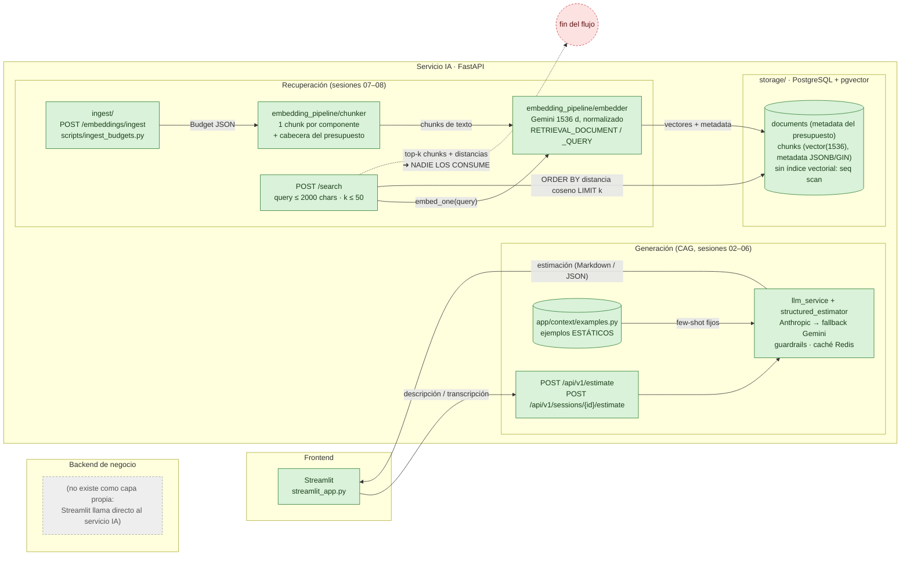
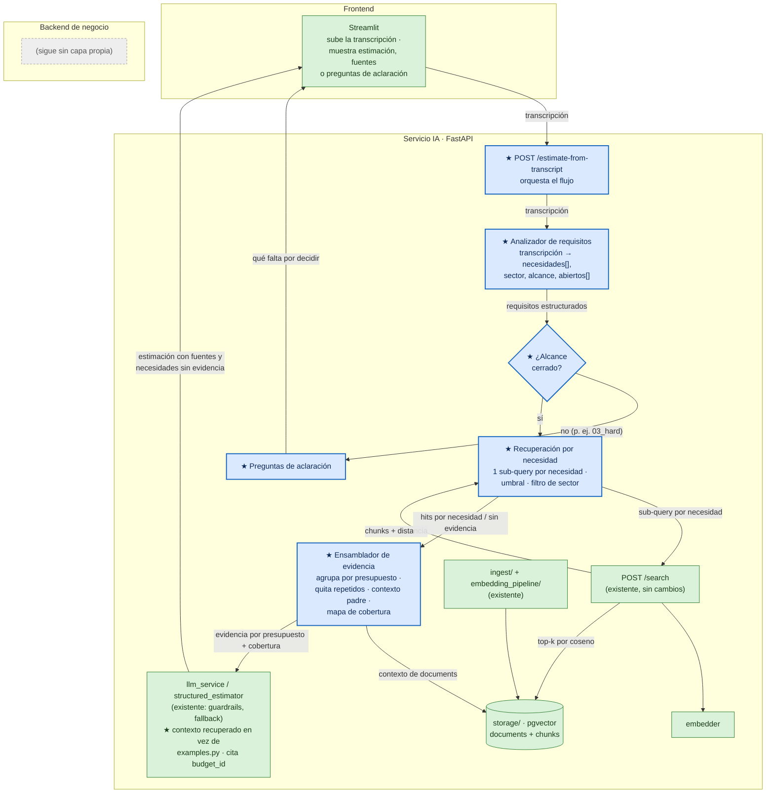

# Diagnóstico arquitectónico — Sesión 09 (pre-work)

Estado del servicio IA al cierre de la Sesión 08 (rama `session-08-pgvector-busqueda`) y lo que
pasa cuando le llega una transcripción cruda. Las trazas son reales: Docker local, Postgres 16 +
pgvector con los 15 presupuestos de `data/budgets/` (58 chunks), embeddings `gemini-embedding-001`
a 1536 dimensiones. Coste de toda la traza: 0 $ (tier gratuito de Gemini).

---

## 1. Diagrama de la arquitectura actual

Correspondencia con los nombres del enunciado: `ingest/` → `POST /embeddings/ingest`
(`app/embedding_pipeline/router.py`) + `scripts/ingest_budgets.py`; `embedding_pipeline/` →
`chunker.py` + `embedder.py`; `storage/` → `app/db/` (modelos, `DocumentRepository`) + Alembic.

No hay un backend de negocio separado: Streamlit habla directamente con el servicio FastAPI, que
también hace el papel de backend (sesiones, guardrails, caché).



**Dónde acaba lo implementado.** En verde está todo lo que existe y funciona. El flujo de
recuperación termina en `/search`: devuelve chunks y distancias, pero ninguna pieza los usa. Las
dos mitades del servicio no están conectadas: el generador (`llm_service.py:67`) sigue tirando de
los ejemplos fijos de `app/context/examples.py`, y lo que hay en pgvector no llega nunca al
prompt. Si llega una transcripción, va por la rama CAG o por `/search`, nunca de una a la otra.

---

## 2. Trace anotado de `02_ambiguous.txt`

**Qué pide el cliente** (Rubén, tienda gourmet física desde 1992, sin cultura técnica), entre
anécdotas del padre, la sobrina, el cuaderno y un primo en Francia, son cinco necesidades:
(N1) tienda online con catálogo y compra, (N2) fidelización por puntos o club, (N3) panel con los
pedidos, lo más vendido y el stock, (N4) pago con tarjeta sin abandonos y (N5) un correo de
confirmación del pedido. España de momento. Pide «un número».

Fichero: 2854 caracteres, unos 890 tokens (`cl100k_base`). Todas las llamadas están en
[`scripts/trace_s09.py`](scripts/trace_s09.py) (solo cliente: usa el embedder y el repositorio sin
tocarlos). La salida completa está en [`examples/trace/`](examples/trace/).

```bash
docker compose up -d                                   # api + postgres + redis
uv run python scripts/ingest_budgets.py                # seed (409 si ya está cargado)
uv run python scripts/trace_s09.py examples/transcripts/02_ambiguous.txt
```

### Paso 1 — Embeber la transcripción completa

No hay un endpoint que embeba texto libre: `/embeddings/ingest` solo acepta un `Budget` JSON. Así
que el paso 1 llama al módulo directamente, con el mismo `task` que usa `/search`:

```python
vector = get_cached_embedder().embed_one(transcript, "query")   # RETRIEVAL_QUERY
```

```json
{
  "provider": "gemini",
  "model": "gemini-embedding-001",
  "dimensions": 1536,
  "l2_norm": 1.0,
  "first_component": -0.026480070229876022,
  "last_component": -0.0021965014736055233
}
```

> Un solo vector de 1536 componentes, normalizado, para cinco necesidades distintas más todo el
> relleno de la conversación. Es una especie de «centro de gravedad» de la reunión, que tira hacia
> «comercio minorista online», sin ninguna dirección propia para la fidelización, el panel o el
> correo. Las componentes sueltas no dicen nada por sí mismas, y eso ya es un aviso: no hay forma
> de saber qué parte de la transcripción pesa más en el vector.

### Paso 2 — Búsqueda semántica (top-5)

**2a. `/search` con la transcripción completa**, que es lo que haría cualquier cliente:

```bash
python -c "import json;print(json.dumps({'query':open('examples/transcripts/02_ambiguous.txt',encoding='utf8').read(),'k':5}))" \
  | curl -s -X POST http://localhost:8000/search -H "Content-Type: application/json" --data-binary @-
```

```json
HTTP 422
{"detail": [{"type": "string_too_long", "loc": ["body", "query"],
  "msg": "String should have at most 2000 characters", "ctx": {"max_length": 2000}}]}
```

> El endpoint ni siquiera acepta la transcripción: `SearchRequest.query` tiene `max_length=2000` y
> esta reunión de cinco minutos ocupa 2854 caracteres. Una reunión real de una hora no cabría de
> ninguna manera.

**2b. Top-5 con el vector del paso 1** (el mismo SQL que `/search`, mediante
`DocumentRepository.nearest_chunks`), para ver qué devolvería sin el límite:

| # | chunk | presupuesto · componente | sector | distancia |
|---|---|---|---|---|
| 1 | 28 | BUD-2024-002 · CAT-001 *Product catalog and search* | ecommerce | 0.3142 |
| 2 | 29 | BUD-2024-002 · CART-001 *Cart and checkout* | ecommerce | 0.3144 |
| 3 | 48 | BUD-2025-009 · VEND-001 *Vendor onboarding* | ecommerce | 0.3151 |
| 4 | 51 | BUD-2025-009 · REV-001 *Reviews and ratings moderation* | ecommerce | 0.3215 |
| 5 | 11 | BUD-2022-021 · ADMIN-001 *Merchant backoffice* | finance | 0.3227 |

Distribución de la distancia contra los 58 chunks del corpus:

```json
{ "chunks": 58, "min": 0.3142, "p50": 0.3443, "max": 0.3915,
  "spread_top1_to_top5": 0.0086, "spread_min_to_max": 0.0773 }
```

**2c. `/search` con la transcripción cortada a 2000 caracteres** (lo máximo que admite hoy):

```bash
python -c "import json;print(json.dumps({'query':open('examples/transcripts/02_ambiguous.txt',encoding='utf8').read()[:2000],'k':5}))" \
  | curl -s -X POST http://localhost:8000/search -H "Content-Type: application/json" --data-binary @-
```

Respuesta cruda (HTTP 200). El campo `query` se ha abreviado; el `content` va íntegro:

```json
{
  "query": "<2000 chars, ends with: ...'[00:03:40] Consultor: Totalmente. ¿Tenéis volumen previsto,'>",
  "k": 5,
  "search_time_ms": 442,
  "results": [
    {
      "chunk_id": 28, "document_id": 8, "chunk_type": "budget_component",
      "content": "[Project: Headless fashion e-commerce store with fast product search]\n[Client sector: ecommerce | Year: 2024 | Main tech: nodejs]\n\nComponent: Product catalog and search\nDescription: Product catalog with variants (size, colour), faceted search, typo tolerance and synonym handling, indexed from the product database in near real time.\nTech stack: nodejs, elasticsearch, postgresql\nComplexity: medium\nEstimated hours: 110",
      "distance": 0.3249320983886671,
      "metadata": {"year": 2024, "budget_id": "BUD-2024-002", "complexity": "medium", "tech_stack": ["nodejs", "elasticsearch", "postgresql"], "component_id": "CAT-001", "client_sector": "ecommerce", "estimated_hours": 110, "main_technology": "nodejs"}
    },
    {
      "chunk_id": 48, "document_id": 13, "chunk_type": "budget_component",
      "content": "[Project: Multi-vendor marketplace for consumer electronics]\n[Client sector: ecommerce | Year: 2025 | Main tech: java_spring]\n\nComponent: Vendor onboarding\nDescription: Self-service vendor registration, business document upload, approval workflow and catalogue import from CSV files.\nTech stack: java_spring, postgresql, s3\nComplexity: medium\nEstimated hours: 80",
      "distance": 0.32528690545040817,
      "metadata": {"year": 2025, "budget_id": "BUD-2025-009", "complexity": "medium", "tech_stack": ["java_spring", "postgresql", "s3"], "component_id": "VEND-001", "client_sector": "ecommerce", "estimated_hours": 80, "main_technology": "java_spring"}
    },
    {
      "chunk_id": 29, "document_id": 8, "chunk_type": "budget_component",
      "content": "[Project: Headless fashion e-commerce store with fast product search]\n[Client sector: ecommerce | Year: 2024 | Main tech: nodejs]\n\nComponent: Cart and checkout\nDescription: Persistent cart, guest and registered checkout, address validation, shipping options and card payments with 3-D Secure through Stripe.\nTech stack: nodejs, stripe, redis\nComplexity: high\nEstimated hours: 120",
      "distance": 0.3264668389280523,
      "metadata": {"year": 2024, "budget_id": "BUD-2024-002", "complexity": "high", "tech_stack": ["nodejs", "stripe", "redis"], "component_id": "CART-001", "client_sector": "ecommerce", "estimated_hours": 120, "main_technology": "nodejs"}
    },
    {
      "chunk_id": 11, "document_id": 3, "chunk_type": "budget_component",
      "content": "[Project: Card payments gateway for small online merchants]\n[Client sector: finance | Year: 2022 | Main tech: nodejs]\n\nComponent: Merchant backoffice\nDescription: Web backoffice for merchants to see payments, issue refunds, download settlement reports and manage API keys and team members.\nTech stack: react, nodejs, postgresql\nComplexity: medium\nEstimated hours: 90",
      "distance": 0.3338655233383131,
      "metadata": {"year": 2022, "budget_id": "BUD-2022-021", "complexity": "medium", "tech_stack": ["react", "nodejs", "postgresql"], "component_id": "ADMIN-001", "client_sector": "finance", "estimated_hours": 90, "main_technology": "nodejs"}
    },
    {
      "chunk_id": 51, "document_id": 13, "chunk_type": "budget_component",
      "content": "[Project: Multi-vendor marketplace for consumer electronics]\n[Client sector: ecommerce | Year: 2025 | Main tech: java_spring]\n\nComponent: Reviews and ratings moderation\nDescription: Verified-purchase product reviews, star ratings, vendor replies and a moderation queue with profanity filtering.\nTech stack: java_spring, postgresql\nComplexity: low\nEstimated hours: 40",
      "distance": 0.3354213633882175,
      "metadata": {"year": 2025, "budget_id": "BUD-2025-009", "complexity": "low", "tech_stack": ["java_spring", "postgresql"], "component_id": "REV-001", "client_sector": "ecommerce", "estimated_hours": 40, "main_technology": "java_spring"}
    }
  ]
}
```

> El corte cae en el minuto 03:40 y se pierde el final: que el mercado es España (y quizá Francia),
> el correo de confirmación (N5) y la petición de un precio. El endpoint no avisa. Aun así, el
> top-5 es **el mismo conjunto** que en 2b, solo reordenado y con unas centésimas más de distancia.
> Quitar un tercio de la reunión casi no mueve el resultado: el vector lo domina el tema general
> «tienda online».

### Paso 3 — Lectura de los chunks devueltos

| chunk | presupuesto histórico | sector | ¿relevante para Rubén? |
|---|---|---|---|
| CAT-001 | BUD-2024-002 ModaNova, e-commerce headless de moda | ecommerce | **Sí (N1).** Catálogo con buscador. Sobra Elasticsearch para el catálogo pequeño de una tienda gourmet, pero es la pieza correcta. |
| CART-001 | BUD-2024-002 ModaNova | ecommerce | **Sí (N4).** Carrito, checkout y tarjeta con 3-D Secure vía Stripe: justo lo que pide («que no se me vayan en el último paso»). Es el mejor resultado de la lista. |
| VEND-001 | BUD-2025-009 TechMarket, marketplace multivendedor | ecommerce | **No.** Alta de vendedores externos. Rubén es el único vendedor. Entra por parecerse a «e-commerce» y por «catalogue import». |
| REV-001 | BUD-2025-009 TechMarket | ecommerce | **No.** Reseñas y moderación, que nadie ha pedido. Ocupa un hueco que debería ser de la fidelización o del panel. |
| ADMIN-001 | BUD-2022-021 PayFlow, pasarela de pagos | finance | **Parcial (N3).** Es un backoffice para ver pagos y reembolsos, lo más parecido a «el panel del café» que sale. Pero es del panel de una pasarela de pagos, otro producto y otro sector. |

> Balance honesto: 2 de 5 son buenos, 1 es parcial y 2 sobran. Las cinco necesidades quedan así:
> N1 y N4 con evidencia, N3 con evidencia débil y N2 y N5 sin nada. Lo que está en el corpus y no
> sale: `PROMO-001` *Promotions engine* (HomeDeco), lo más parecido a la fidelización;
> `ORD-001` *Order management* e `INT-001` *ERP inventory synchronisation*, para el panel de
> pedidos y stock; y `FRONT-001` *Next.js storefront*, el escaparate. Lo que no existe en el corpus
> y nadie avisa: un programa de puntos y un servicio de correo transaccional (solo hay
> `NOTIF-001`, de notificaciones push).

**Comparativa con las otras dos transcripciones** (misma traza, salida en `examples/trace/`):

| transcripción | chars | distancia top-1 | spread top-1→5 | spread del corpus | top-5 |
|---|---|---|---|---|---|
| 01_clear | 1975 | **0.2153** | 0.0454 | 0.1525 | 4 chunks de BUD-2024-014 (banca, OAuth, PSD2) + 1 de AUTH de healthcare |
| 02_ambiguous | 2854 | 0.3142 | **0.0086** | **0.0773** | ver arriba |
| 03_hard | 2397 | 0.2841 | 0.0263 | 0.1124 | 3 de BUD-2024-005 (EHR, vídeo, citas) + 2 de BUD-2025-012 |

> Con la transcripción clara funciona bien: el presupuesto gemelo sale arriba con margen. Con la
> ambigua, la distancia mínima es 0,10 peor y las cinco primeras caben en menos de una centésima.
> En la difícil, la clínica sigue sin decidir el alcance, pero el sistema devuelve con la misma
> seguridad EHR, videoconsulta y citas, como si hubiera un proyecto cerrado.

---

## 3. Diagnóstico: cinco fallos identificados

### Fallo 1 — La transcripción no cabe en `/search`, y cortarla pierde requisitos sin avisar
- **Problema observado:** con la transcripción entera, `/search` devuelve **422** (`max_length=2000`,
  la reunión tiene 2854 caracteres, paso 2a). Al cortarla a 2000 caracteres, el corte cae en el
  minuto 03:40 y desaparecen el correo de confirmación (N5), el mercado y la petición de precio
  (paso 2c), sin ningún aviso.
- **Causa probable:** `/search` está diseñado para una query corta escrita a mano, no para una
  reunión. No hay ninguna pieza entre la transcripción y el buscador.
- **Propuesta de solución:** una etapa previa de análisis de la transcripción que la convierta en
  queries cortas y completas. El límite de 2000 caracteres puede quedarse como está: lo que está
  mal es pasarle la transcripción entera, no el límite.

### Fallo 2 — Las distancias no discriminan: los cinco primeros caben en menos de una centésima
- **Problema observado:** el spread entre el top-1 y el top-5 es de **0,0086** (0,3142 → 0,3227) y
  el de todo el corpus es de 0,077. Del primer chunk al último no hay ni una décima. Con 01_clear,
  ese spread es 5 veces mayor (0,045) y la distancia mínima cae a 0,215.
- **Causa probable:** se embebe la conversación entera, con relleno incluido (el padre, el
  cuaderno, la sobrina, el primo en Francia), en español coloquial. Los chunks son fichas técnicas
  cortas en inglés. El vector resultante es un promedio que queda casi a la misma distancia de todo
  lo que huela a «comercio».
- **Propuesta de solución:** no embeber nunca la transcripción cruda. Primero hay que extraer una
  representación estructurada de lo que pide (función, sector, alcance, restricciones) y embeber
  eso, en el mismo registro y el mismo idioma que los chunks del corpus.

### Fallo 3 — Cinco necesidades en un solo vector: tres se quedan sin evidencia
- **Problema observado:** de las cinco necesidades, solo N1 (catálogo) y N4 (checkout) tienen un
  chunk claro en el top-5. N3 (panel) tiene uno débil y de otro sector, y N2 (fidelización) y N5
  (correo) no tienen nada. Mientras tanto, VEND-001 y REV-001, que nadie ha pedido, ocupan dos de
  los cinco huecos. `PROMO-001`, `ORD-001` e `INT-001` existen en el corpus y no salen.
- **Causa probable:** la recuperación es una única búsqueda top-k con un único vector. La
  necesidad dominante, «tienda online», se queda con todos los huecos, y las secundarias nunca
  llegan a competir.
- **Propuesta de solución:** descomponer la petición en una sub-query por necesidad, buscar cada
  una por separado y juntar los resultados, de forma que cada necesidad tenga su propia evidencia
  (o la ausencia de ella).

### Fallo 4 — Siempre devuelve k resultados: no sabe decir «no tengo nada parecido»
- **Problema observado:** `/search` devuelve 5 chunks para 02 aunque su mejor distancia (0,314) está
  casi en la mediana de 01 (0,32): el mejor resultado de 02 es un resultado mediocre de 01. En el corpus no hay ningún programa de puntos ni ningún
  correo transaccional, y nada lo indica. En 03_hard, con un alcance que la clienta deja abierto,
  devuelve EHR, vídeo y citas con la misma seguridad que una petición cerrada.
- **Causa probable:** `nearest_chunks` es un `ORDER BY ... LIMIT k` sin umbral y la respuesta no
  dice nada sobre la cobertura. La ambigüedad del alcance tampoco se detecta en ningún punto.
- **Propuesta de solución:** un umbral de distancia calibrado con las tres transcripciones (no
  inventado) y un informe de cobertura por necesidad: con evidencia o sin evidencia. Si el alcance
  sigue abierto, como en 03, el sistema debería devolver preguntas de aclaración en vez de una
  estimación.

### Fallo 5 — Lo recuperado no llega al estimador, y además llega incompleto
- **Problema observado:** el top-5 de `/search` no lo consume ninguna pieza (sección 1). El
  estimador genera a partir de los ejemplos fijos de `app/context/examples.py`
  (`llm_service.py:67`). Y aunque se conectara, el top-5 de 02 cubre solo 3 presupuestos (dos se
  repiten dos veces) y cada chunk trae las horas de su componente, pero no el total del
  presupuesto ni sus otros componentes (que están en `documents.metadata`).
- **Causa probable:** la recuperación (sesiones 07–08) y la generación (sesiones 02–06) se
  construyeron por separado y no hay un contrato entre ellas. El chunk por componente es bueno para
  buscar, pero no es la unidad que necesita un estimador.
- **Propuesta de solución:** un ensamblador de contexto que agrupe los chunks por presupuesto,
  quite los repetidos, traiga de `documents` el contexto del presupuesto padre (horas totales,
  año, tecnología) y entregue al generador evidencia citable (`budget_id`), en lugar de los
  ejemplos estáticos.

### Otros
- **El filtro por sector no se usa.** `client_sector` está en la metadata (con índice GIN), pero
  `/search` no filtra por él. En 02 entra un chunk de `finance` (ADMIN-001). El sector no se
  menciona, pero «tienda gourmet que quiere vender online» deja claro que es ecommerce.
- **La cabecera de proyecto pesa demasiado.** Dos de los cinco huecos se los llevan componentes
  hermanos del mismo presupuesto (ModaNova ×2, TechMarket ×2), igual que en 01 (4 de BUD-2024-014).
  Es lo mismo que se vio en la S07: similitud mediana de 0,845 entre chunks del mismo presupuesto
  frente a 0,724 entre presupuestos distintos.
- **Idioma.** Las queries están en español y el corpus en inglés. Con Gemini no impide recuperar
  (01 funciona), pero puede ser parte de la compresión del fallo 2. No lo he aislado.
- **Latencia.** `/search` tarda unos 440 ms, de los que 4–5 ms son de base de datos (logs
  `semantic_search`). Casi todo es el embedding. Con 58 chunks, que no haya índice HNSW no es el
  cuello de botella.

---

## 4. Propuesta de evolución arquitectónica

En azul y con ★ lo nuevo. En verde lo que ya existe y se reutiliza.



El **orquestador** (`/estimate-from-transcript`) recibe la transcripción y encadena el resto. El
**analizador de requisitos** la convierte en necesidades en el idioma del corpus, sector, alcance
y puntos abiertos (fallos 1 y 2). La **puerta de alcance** desvía casos como 03 a **preguntas de
aclaración** en vez de inventar una estimación (fallo 4). La **recuperación por necesidad** lanza
una sub-query por necesidad contra el `/search` actual, con umbral y filtro de sector, y devuelve
hits o «sin evidencia» (fallos 3 y 4). El **ensamblador** agrupa por presupuesto, quita repetidos,
completa con `documents` y pasa al **generador** existente, ya sin `examples.py`, evidencia citable
y un mapa de cobertura (fallo 5). La pieza que atacaría primero es el **analizador**: los fallos
1 a 3 nacen de embeber la reunión cruda, y 01_clear demuestra que el mismo retriever funciona bien
cuando recibe una query que ya parece una lista de requisitos.
